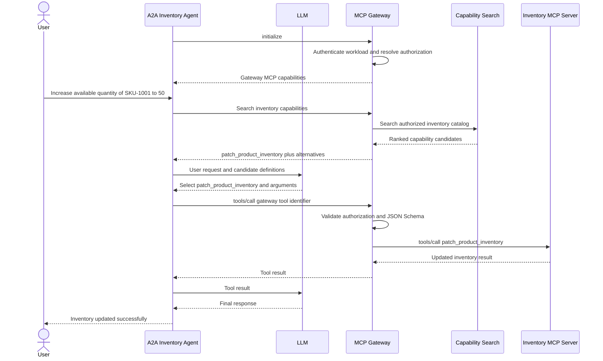

# py-inventory-a2a-v2
py-inventory-a2a-v2


### Todo

implement Cedar

### activate
```sh
# env installed 2 folder above
source ../../.venv/bin/activate
```
### install dependecies
```sh
pip install -e .
```

### Allowed hosts

Set `ALLOWED_HOSTS` to a comma-separated list of hostnames, such as
`localhost,127.0.0.1,py-inventory-a2a-v2`. The optional `:*` suffix is accepted
for compatibility; host validation ignores ports. If unset, all hosts are
allowed (`*`), as before.

```
OBSERVE : get_product(sku)
   ↓
BUILD STATE : get_product_history(sku)
   ↓
DECIDE
   ↓
VALIDATE DECISION
   ↓
ACT
   ↓
VERIFY RESULT
   ↓
STORE EXPERIENCE
   ↓
OBSERVE AGAIN
```


```
# skills
check_inventory()             → deterministic
calculate_stock_coverage()    → deterministic
calculate_slope()              → Stats A2A
assess_stockout_risk()         → rules/model
decide_replenishment()         → agent + policy
request_replenishment()        → deterministic action

Inventory Skills
│
├── Observation
│   ├── check_inventory
│   ├── get_product_status
│   └── get_pending_orders
│
├── Analysis
│   ├── analyze_inventory_level
│   ├── calculate_stock_coverage
│   ├── analyze_sales_velocity
│   └── assess_stockout_risk
│
├── Decision
│   ├── evaluate_replenishment
│   ├── evaluate_halt
│   └── recommend_action
│
└── Action
    ├── request_replenishment
    ├── halt_product
    └── verify_action
```

```
| Component           | Responsibility                                 |
| ------------------- | ---------------------------------------------- |
| **A2A**             | Communication between agents                   |
| **Orchestrator**    | Coordinate agents/capabilities                 |
| **Reasoning**       | Interpret evidence and determine what it means |
| **Decision Engine** | Apply decision criteria/policies               |
| **State**           | Remember workflow progress                     |
| **Action Executor** | Perform side effects                           |
| **Domain**          | Business rules and models                      |
```

```
1. "Which capability/server can satisfy this requirement?"
                 ↓
             Registry

2. "Now that I know what capability I need, how do I observe?"
                 ↓
             Observer
```

TODO

mcp dynamic registration pkce
evals
confidende scores





{
  "name": "catalog_search",
  "description": "Finds authorized MCP tools, prompts, and resources relevant to a task.",
  "inputSchema": {
    "type": "object",
    "properties": {
      "query": {
        "type": "string"
      },
      "capabilityTypes": {
        "type": "array",
        "items": {
          "type": "string",
          "enum": [
            "TOOL",
            "PROMPT",
            "RESOURCE",
            "RESOURCE_TEMPLATE"
          ]
        }
      },
      "serverIds": {
        "type": "array",
        "items": {
          "type": "string"
        }
      },
      "limit": {
        "type": "integer",
        "minimum": 1,
        "maximum": 20,
        "default": 5
      }
    },
    "required": [
      "query"
    ],
    "additionalProperties": false
  }
}


{
  "name": "catalog_search",
  "arguments": {
    "query": "update the available, sold, and pending inventory quantities for a SKU",
    "capabilityTypes": [
      "TOOL"
    ],
    "serverIds": [
      "py-mcp-inventory-v2-01"
    ],
    "limit": 5
  }
}


Step 1: Agent searches catalog
{
  "name": "catalog_search",
  "arguments": {
    "query": "update SKU inventory available 50 pending 5 sold 10",
    "capabilityTypes": [
      "TOOL",
      "PROMPT"
    ],
    "serverIds": [
      "py-mcp-inventory-v2-01"
    ],
    "limit": 5
  }
}

Step 2: Gateway returns candidates
{
  "results": [
    {
      "capabilityId": "py-mcp-inventory-v2-01:TOOL:patch_product_inventory",
      "type": "TOOL",
      "name": "patch_product_inventory",
      "score": 0.96
    },
    {
      "capabilityId": "py-mcp-inventory-v2-01:PROMPT:inventory_patch",
      "type": "PROMPT",
      "name": "inventory_patch",
      "score": 0.88
    },
    {
      "capabilityId": "py-mcp-inventory-v2-01:TOOL:post_product",
      "type": "TOOL",
      "name": "post_product",
      "score": 0.42
    }
  ]
}

Step 3: Agent loads the exact definition
{
  "capabilityId": "py-mcp-inventory-v2-01:TOOL:patch_product_inventory"
}

Step 4: LLM creates arguments
{
  "payload": {
    "sku": "SKU-1001",
    "inventory": {
      "available": 50,
      "sold": 10,
      "pending": 5
    }
  }
}

Step 5: Agent calls the gateway
{
  "name": "py-mcp-inventory-v2-01.patch_product_inventory",
  "arguments": {
    "payload": {
      "sku": "SKU-1001",
      "inventory": {
        "available": 50,
        "sold": 10,
        "pending": 5
      }
    }
  }
}

Step 6: Gateway validates and routes
Resolve registered capability
→ validate current authorization
→ validate arguments against exact JSON Schema
→ confirm write policy
→ route to py-mcp-inventory-v2-01
→ call downstream patch_product_inventory
→ return result


´´´json
{
    "agent_id": "py-statistic-a2a-v2-1",
    "name": "Production py-statistic-a2a-v2 agent",
    "description": "Order lookup and reservation capabilities",
    "endpoint": {
        "url": "http://127.0.0.1:7600",
        "transport": "json-rpc"
    },
    "authentication": {
        "type": "oauth2",
        "audience": "py-statistic-a2a-v2"
    },
    "discovery": {
        "enabled": true,
        "refresh_interval_seconds": 900
    },
    "status": "ACTIVE",
    "created_at": "2026-11-03T20:20:00-03:00"
}

{
    "agent_id": "py-inventory-a2a-v2",
    "name": "Production py-inventory-a2a-v2 agent",
    "description": "Inventory agent capabilities",
    "endpoint": {
        "url": "http://127.0.0.1:7601",
        "transport": "json-rpc"
    },
    "authentication": {
        "type": "oauth2",
        "audience": "py-inventory-a2a-v2"
    },
    "discovery": {
        "enabled": true,
        "refresh_interval_seconds": 900
    },
    "status": "ACTIVE",
    "created_at": "2026-11-03T20:20:00-03:00"
}

{
    "server_id": "py-mcp-order-v2",
    "name": "Production order MCP Server",
    "description": "Order lookup and reservation capabilities",
    "endpoint": {
        "url": "http://127.0.0.1:7501/mcp",
        "transport": "streamable-http"
    },
    "authentication": {
        "type": "oauth2",
        "audience": "py-mcp-order-v2"
    },
    "discovery": {
        "enabled": true,
        "refresh_interval_seconds": 900
    },
    "status": "ACTIVE",
    "created_at": "2026-11-03T20:20:00-03:00"
}

{
    "server_id": "py-mcp-inventory-v2",
    "name": "Inventory order MCP Server",
    "description": "Inventory lookup and reservation capabilities",
    "endpoint": {
        "url": "http://127.0.0.1:7500/mcp",
        "transport": "streamable-http"
    },
    "authentication": {
        "type": "oauth2",
        "audience": "py-mcp-inventory-v2"
    },
    "discovery": {
        "enabled": true,
        "refresh_interval_seconds": 900
    },
    "status": "ACTIVE",
    "created_at": "2026-11-03T20:20:00-03:00"
}
```